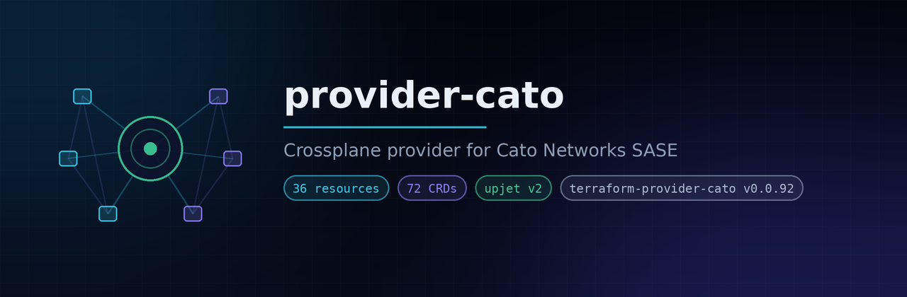

# provider-cato

A [Crossplane](https://crossplane.io/) provider for [Cato Networks](https://www.catonetworks.com/),
generated with [Upjet](https://github.com/crossplane/upjet) from the
[catonetworks/cato](https://registry.terraform.io/providers/catonetworks/cato) Terraform provider.

It manages sites, network ranges, interfaces, security policies and private access through the Cato
Management Application API. 36 of the 41 resources in terraform-provider-cato v0.0.92 are covered,
each published as a cluster-scoped CRD under `*.cato.crossplane.io` and a namespaced CRD under
`*.cato.m.crossplane.io`, which is 72 managed resource CRDs in total.

## Install

```console
kubectl apply -f - <<EOF
apiVersion: pkg.crossplane.io/v1
kind: Provider
metadata:
  name: provider-cato
spec:
  package: xpkg.crossplane.io/polarpoint-io/provider-cato:v0.1.0
EOF
```

## Credentials

The provider reads its Terraform provider configuration from a JSON secret. The keys are the
argument names of the underlying Terraform provider. `token` is a Cato Management Application API
key and `account_id` the CMA account it belongs to; both are required. `baseurl`, `retry_max`,
`retry_wait_max_seconds` and `retry_wait_min_seconds` are passed through when present.

```console
kubectl create secret generic cato-creds -n crossplane-system \
  --from-literal=credentials='{"token":"'"$CATO_TOKEN"'","account_id":"'"$CATO_ACCOUNT_ID"'"}'
```

```yaml
apiVersion: cato.crossplane.io/v1beta1
kind: ProviderConfig
metadata:
  name: default
spec:
  credentials:
    source: Secret
    secretRef:
      name: cato-creds
      namespace: crossplane-system
      key: credentials
```

Namespaced managed resources use either a namespaced `ProviderConfig` or a `ClusterProviderConfig`
in the `cato.m.crossplane.io` group. See `examples/namespaced/providerconfig/`.

## Usage

```yaml
apiVersion: site.cato.crossplane.io/v1alpha1
kind: NetworkRange
metadata:
  name: branch-office-vlan-100
spec:
  forProvider:
    siteId: "123456"
    name: branch-office-vlan-100
    rangeType: VLAN
    subnet: 10.20.100.0/24
    vlan: 100
  providerConfigRef:
    name: default
```

More examples live in `examples/` (hand written) and `examples-generated/` (derived from the
Terraform registry docs).

## API groups

Upjet derives an API group from the second word of a Terraform resource name, which here would
produce a group per policy type and per interface type (`if`, `wf`, `wnw`, `tls`, `socket`, `app`,
`private`, `lan`, `wan`, `bgp`). The resources are instead grouped by what they configure. The
mapping lives in [config/overrides.go](config/overrides.go).

| Group | Resources | Contents |
| --- | ---: | --- |
| `policy.cato.crossplane.io` | 18 | Internet firewall, WAN firewall, WAN network, TLS inspection, application control and app tenant restriction rules, sections and sub-policies |
| `site.cato.crossplane.io` | 9 | Socket and IPsec sites, network ranges, static hosts, LAN/WAN interfaces, LAG members, BGP peers, licences |
| `access.cato.crossplane.io` | 5 | Private access policy and rules, private apps, app connectors |
| `admin.cato.crossplane.io` | 4 | Accounts, admins, groups, group members |

Every group also exists with an `.m.` infix for the namespaced variants, for example
`site.cato.m.crossplane.io`.

## External names

The Cato Management Application assigns every object an opaque ID on create, so nothing is named by
the user: the external name annotation carries the CMA ID and `metadata.name` is free to be whatever
you like. To adopt an existing object, set `crossplane.io/external-name` to its CMA ID and use
`managementPolicies: ["Observe", "Update", "LateInitialize"]`.

The policy rule resources (`cato_if_rule`, `cato_wf_rule`, `cato_wnw_rule`,
`cato_socket_lan_firewall_rule`, `cato_socket_lan_network_rule`) need a little more than that.
terraform-provider-cato is built on terraform-plugin-framework, which unlike the SDK does not
require a top-level `id` attribute, and these resources keep their ID inside the `rule` object
instead. They use a custom external name that reads `rule.id`; see `nestedRuleID` in
[config/external_name.go](config/external_name.go).

## Resources that are not generated

Five Terraform resources are deliberately skipped:

| Resource | Reason |
| --- | --- |
| `cato_bulk_if_move_rule` | Reorders rules that other resources own |
| `cato_bulk_tls_move_rule` | Reorders rules that other resources own |
| `cato_bulk_wf_move_rule` | Reorders rules that other resources own |
| `cato_bulk_wnw_move_rule` | Reorders rules that other resources own |
| `cato_global_ip_ranges` | Replaces an account-wide list wholesale |

None of them has an identity of its own in Terraform state, so there is nothing for a managed
resource's external name to point at and every reconcile would re-run the operation. Rule ordering
is expressed through the `at` field on the rule resources themselves. The list is in
`SkippedResources` in [config/external_name.go](config/external_name.go).

## Development

Regenerate everything after bumping `TERRAFORM_PROVIDER_VERSION` in the Makefile:

```console
make generate
```

`make generate` pulls the Terraform provider schema, clones the provider's registry docs, runs
`scripts/normalize-docs.py` over them, scrapes `config/provider-metadata.yaml`, then runs the Upjet
pipeline, controller-gen and angryjet. The normalisation step fills in front matter keys that
upjet's scraper requires and labels import code fences; it is idempotent.

Run against a cluster:

```console
make run
```

Build and install:

```console
make all
```

## Report a bug

Open an [issue](https://github.com/polarpoint-io/provider-cato/issues).
